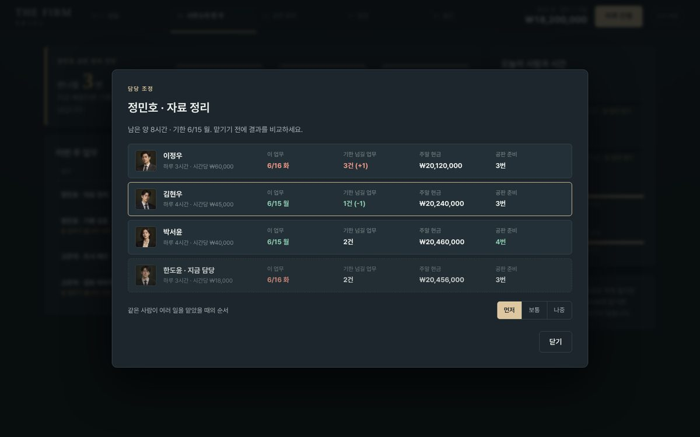
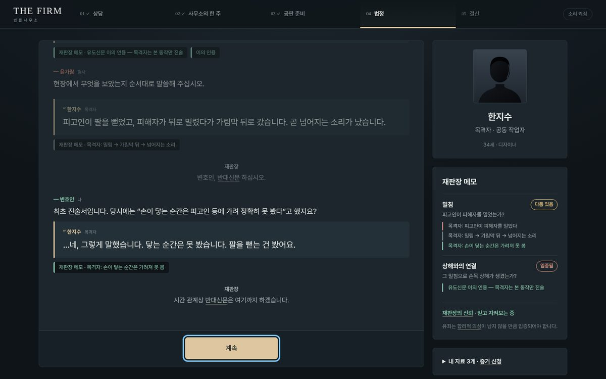
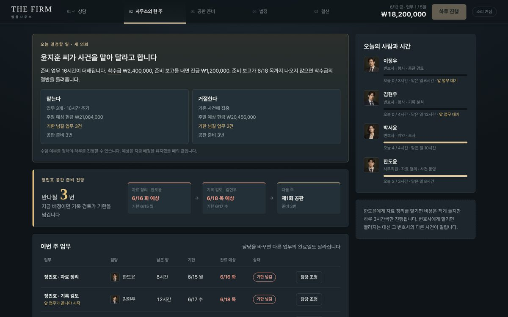
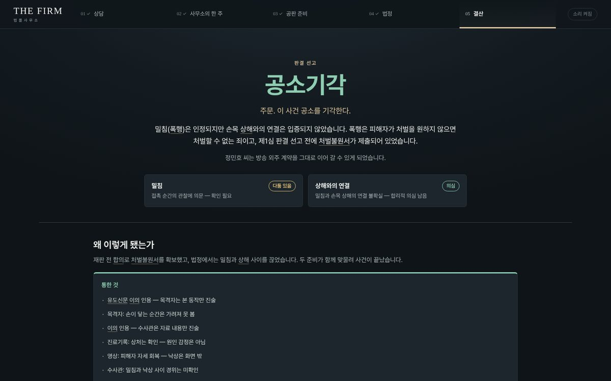

# THE FIRM

변호사·로펌 시뮬레이션. 준비한 것을 들고 상대와 다투고, 그 기록이 판결과 커리어로 돌아오는 게임을 만들고 있습니다.

## 지금 플레이할 수 있는 것 — [`game/`](game/README.md)

**한 주, 그리고 한 번의 재판** (10~15분). `game/index.html`을 브라우저로 열면 됩니다.

| 사무소: 누구에게 맡길지 비교하고 정한다 | 법정: 준비한 자료로 증인의 말을 좁힌다 |
|---|---|
|  |  |
|  |  |

- 사무소의 배정이 기록 검토 완료일을 바꾸고, 그 완료일이 공판 전 조사 횟수(4/3/2)를 정합니다.
- 법정에는 무작위가 없습니다. 판결은 남은 기록만으로 설명됩니다.
- 판세와 신뢰는 숫자가 아니라 문장으로 보입니다. 용어는 눌러서 겹쳐 읽을 수 있습니다.

## AI와 어떻게 만들었나

코드 대부분을 AI 에이전트(Claude, Codex)가 썼고, 사람은 방향·범위·병합을 결정했습니다. 그 분업을 문서로 고정해 두었습니다.

| 무엇 | 어디 |
|---|---|
| 에이전트 규칙: 실험/생산 두 레인, 읽을 문서 예산, 범위 밖 수정 금지 | [AGENTS.md](AGENTS.md) |
| 작업 단위 계약서(목표·금지 범위·완료 기준) | [.agent/tasks/](.agent/tasks/) |
| 계획 → 계약 → 구현 → 테스트 → 교차 리뷰 → 커밋 | [WORKFLOW.md](WORKFLOW.md) |
| 지금 상태와 미결정 사항 | [docs/CURRENT.md](docs/CURRENT.md) · [docs/CHANGELOG.md](docs/CHANGELOG.md) |
| 설계 결정 기록(DEC)과 그 검증 시나리오(TEST) | 저장소 루트 `DEC-*`, `TEST-*` |
| 버린 시도와 그 이유 | `task/experiment-archive-2026-11-16` 브랜치 |

## 저장소 지도

- `game/` — 플레이 가능한 한 판(위).
- `courtroom-prototype/` — 법정 엔진 실험(v0.9.1 신문 법정, v0.10 대립 공판).
- `litigation-skeleton/` — Godot 조사 슬라이스(보관).
- `docs/` — 현황, 변경 기록, 설계 메모, 한국 법조 통계 참고 자료.

한국을 닮은 가상의 법 세계입니다. 절차와 형량은 게임을 위해 단순화했으며 법률 조언이 아닙니다.
