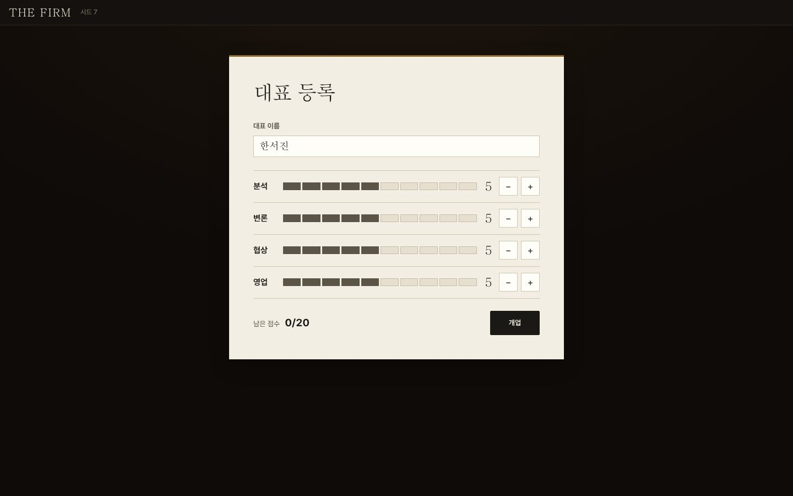
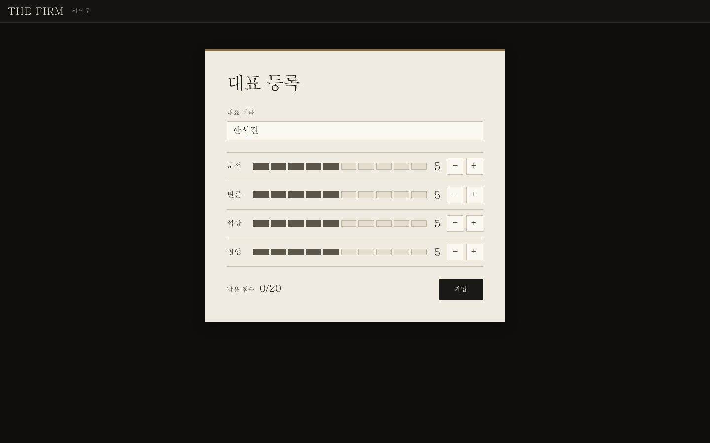
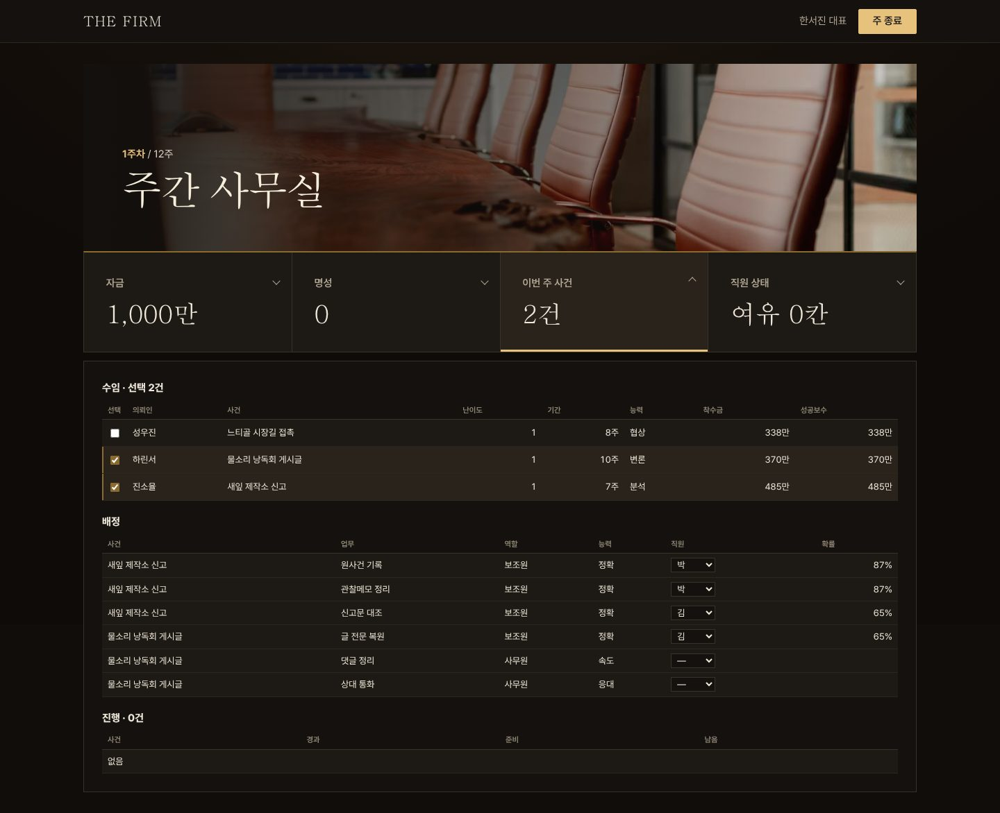
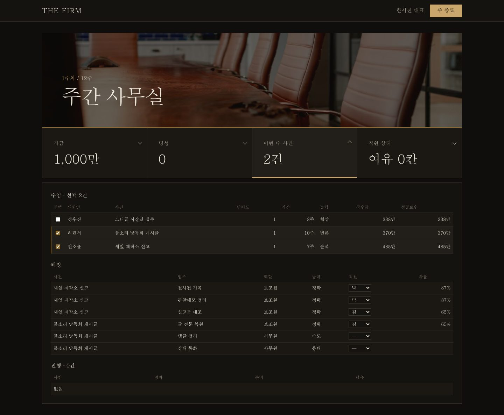
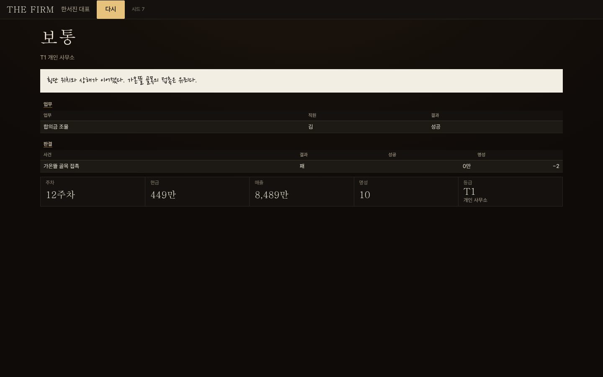
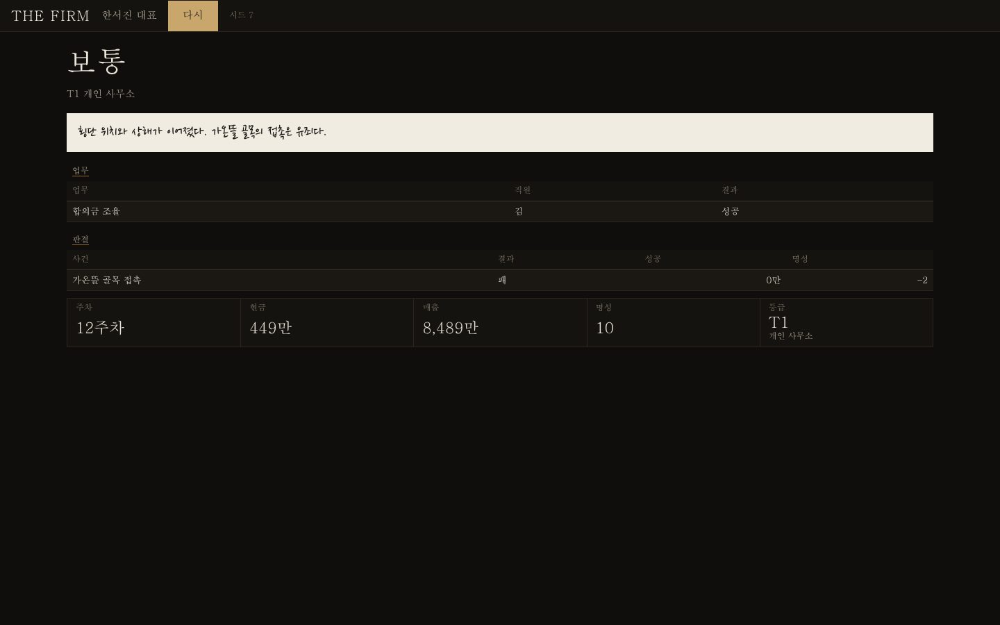

# 디자인 토큰 (UI-TOKENS)

값은 [`src/tokens.css`](src/tokens.css) 한 곳에만 있다. [`src/style.css`](src/style.css)는 `var(--…)`만 쓰고, 숫자로 적힌 값은 미디어 쿼리 폭(860·760·640·480px)뿐이다. CSS 변수는 미디어 쿼리 조건에 쓸 수 없기 때문이다.

방향은 Football Manager 2027처럼 차분한 업무 화면이다. 면은 평평하고, 강조색은 황동 한 가지이며 화면의 1~2%에만 쓴다. 그라데이션, 둥근 모서리, 이모지 장식은 쓰지 않는다.

색은 두 층으로 나눈다. 재료(primitive: `--walnut-*`, `--paper-*`, `--brass-*` …)는 값만 담고, 화면 규칙은 용도(semantic: `--color-*`) 층만 참조한다.

## 글꼴 — 용도별

| 토큰 | 값 | 쓰임 |
|---|---|---|
| `--font-body` | 한양 바탕(`Firm Batang`) → Batang → AppleMyungjo → serif | 본문 전체, 입력칸, 능력치 설명 |
| `--font-heading` | `--font-body` | 화면 제목, 브랜드, 요약 띠·지표 숫자, 엔딩 단어, 툴팁 제목 |
| `--font-note` | 나눔손글씨 펜(`Firm Pen`) | 사건 정리 노트(`.notes`) — 대표가 손으로 적은 결과 메모 |

한양 바탕은 Regular 한 벌뿐이고 `font-synthesis: none`이라 가짜 굵기를 만들지 않는다. 위계는 굵기가 아니라 크기와 색(`--color-text-strong` / `--color-text` / `--color-text-faint`)으로 만든다.

## 글자 크기·행간·자간

| 토큰 | 값 | 쓰임 |
|---|---|---|
| `--text-xs` | 12px | 표 머리, 캡션, 요약 띠 라벨, 시드 |
| `--text-sm` | 13px | 사무실 기본 글자, 표 본문, 상세 항목명 |
| `--text-md` | 14px | 엔딩 부제, 툴팁 본문, 좁은 화면 상단 버튼 |
| `--text-base` | 15px | 문서 본문, 지표 라벨, 주차, 능력치 이름 |
| `--text-lg` | 18px | 대표 이름 입력, ± 버튼, 상세 값 |
| `--text-xl` | 20px | 브랜드, 남은 점수 |
| `--text-2xl` | 22px | 요약 띠 숫자, 노트 필기, 능력치 값 |
| `--text-3xl` | 36px | 서류 제목(대표 등록) |
| `--text-4xl` | 42px | 화면 제목 |
| `--text-display` / `-sm` | 72px / 48px | 엔딩 단어(넓은 / 860px 이하) |
| `--text-metric` | clamp(24px, 2.5vw, 38px) | 사무실 지표 값 |
| `--text-cover` | clamp(38px, 4vw, 60px) | 사무실 표지 제목 |
| `--leading-tight` / `-snug` / `-body` / `-note` | 1.1 / 1.3 / 1.65 / 1.45 | 제목 / 요약 띠 / 본문 / 필기 노트 |
| `--tracking-brand` / `-title` / `-tight` | .08em / .04em / -.04em | 브랜드 / 화면 제목 / 서류·표지 제목 |

## 색 — 용도(semantic)

| 토큰 | 재료 → 값 | 쓰임 |
|---|---|---|
| `--color-bg` | walnut-950 `#100e0c` | 페이지 바탕(평평한 단색) |
| `--color-surface-1` | walnut-900 `#15130f` | 상단 막대, 요약 띠, 표 머리, 선택 상자, 펼친 상세 |
| `--color-surface-2` | walnut-850 `#1b1814` | 표 몸통, 지표 칸, 표지 사진 바탕 |
| `--color-surface-3` | walnut-800 `#221e19` | 선택된 행, hover·펼친 지표 |
| `--color-surface-4` | walnut-750 `#2b2620` | 표 행 hover |
| `--color-line` / `-soft` | `#3a342c` / `#2a2520` | 표 머리 밑줄·버튼·상세 테두리 / 행 구분·요약 띠 칸 |
| `--color-text-strong` | bone-100 `#ece6da` | 본문 기본, 숫자, 상세 캡션 |
| `--color-text` | bone-300 `#b6ad9d` | 보조 글자: 지표 라벨, 캡션, 대표 서명, 엔딩 부제 |
| `--color-text-faint` | bone-500 `#8a8172` | 표 머리, 요약 띠 라벨, 시드 |
| `--color-accent` | brass-400 `#c9a66b` | 주 버튼, 펼친 지표 밑줄, 주차, 버튼 hover 테두리 |
| `--color-accent-hover` | brass-300 `#d6b781` | 주 버튼 hover |
| `--color-accent-ink` | ink-900 | 주 버튼 글자 |
| `--color-accent-line` | brass-700 `#8a6a2f` | 표 캡션 밑줄, 선택 행 표시, 체크박스, 지표 묶음 윗선, 서류 머리 띠 |
| `--color-positive` | brass-400 | 엔딩 "위대한 로펌" |
| `--color-negative` | seal-400 `#d9675a` | 적자 현금, 피로·초과, 엔딩 "폐업" |
| `--color-negative-on-paper` | seal-600 `#a8352c` | 대표 등록의 점수 초과 |
| `--color-focus` | pen-300 `#9fb4ef` | 키보드 포커스 테두리 |
| `--color-hover-wash` | `#ffffff0a` | 일반 버튼 hover 바탕 |
| `--color-paper` | paper-100 `#f1ece1` | 종이: 대표 등록 서류, 사건 정리 노트, 툴팁 |
| `--color-paper-field` | paper-50 `#fbf8f1` | 종이 위 입력칸, ± 버튼 |
| `--color-paper-well` / `-well-line` | `#e4ddcd` / `#c4b9a4` | 능력치 막대의 빈 칸 |
| `--color-paper-line` | paper-300 `#cfc5b0` | 종이 위 줄, 입력칸 테두리 |
| `--color-ink` / `-hover` / `-muted` | `#1b1916` / `#3a352d` / `#5b5448` | 종이 위 글자 / 개업 버튼 hover / 라벨·채운 능력치 칸 |
| `--color-on-image` / `-muted` | bone-100 / `#d7cec1` | 사무실 표지 사진 위 제목 / 전체 주 수 |
| `--color-image-scrim` | rgb(16 14 12 / .62) | 표지 사진을 덮는 균일한 막(그라데이션 대신) |

## 간격 — 4px 격자

| 토큰 | 값 | 대표 쓰임 |
|---|---|---|
| `--space-1` | 2px | 노트 줄 간격, 선택 상자 세로 여백, 툴팁 줄 간격 |
| `--space-2` | 4px | 표 칸 세로 여백, 캡션 아래, 능력치 막대 칸 사이 |
| `--space-3` | 6px | 요약 띠 칸 세로, 상세 표 칸 세로, 얼굴 사진 옆 |
| `--space-4` | 8px | 표 칸 가로 여백, 화면 제목 위, 입력칸 세로 |
| `--space-5` | 10px | 표·요약 띠 아래, 노트·툴팁 세로 여백 |
| `--space-6` | 12px | 화면 위 여백, 요약 띠 칸 가로, 상세 패널 위, 지표 안 간격 |
| `--space-7` | 16px | 상단 막대 가로·간격, 화면 가로 여백, 상세 항목 간격 |
| `--space-8` | 20px | 버튼 가로 여백, 사무실 가로 여백, 상세 블록 사이, 엔딩 단어 위 |
| `--space-9` | 24px | 능력치 목록 위아래, 좁은 화면 서류 여백 |
| `--space-10` | 28px | 서류 제목 아래 |
| `--space-11` | 32px | 사무실 화면 세로 여백 |
| `--space-12` | 40px | 화면 아래 여백, 상세 항목 가로 간격 |
| `--space-13` | 48px | 대표 등록 아래 여백 |
| `--space-cover` / `-metric` / `-detail` / `-sheet` / `-setup-top` | clamp(…) | 표지 / 지표 칸 / 상세 패널 / 서류 / 등록 화면 위 — 화면 폭에 따라 늘어나는 여백 |

## 크기

| 토큰 | 값 | 쓰임 |
|---|---|---|
| `--size-bar` / `-bar-office` | 46px / 62px | 상단 막대 높이(일반 / 사무실) |
| `--size-control` / `-md` / `-sm` | 44px / 40px / 36px | 버튼 최소 높이(기본 / 좁은 화면 상단 / 사무실 상단) |
| `--size-step` | 34px | 능력치 ± 버튼 |
| `--size-row-min` | 58px | 능력치 한 줄 |
| `--size-check-cell` / `-check-min` | 36px / 26px | 수임 선택 칸 |
| `--size-face` | 22px | 직원 얼굴 썸네일 |
| `--size-pip` | 14px | 능력치 막대 칸 높이 |
| `--size-chevron` | 7px | 지표 펼침 꺾쇠 |
| `--size-select-min` | 64px | 배정 선택 상자 |
| `--size-button-min` | 90px | 개업 버튼 |
| `--width-page` / `-office` / `-office-bar` / `-setup` | 1280 / 1240 / 1200 / 640px | 화면 최대 폭 |
| `--width-tip` | 420px | 툴팁 최대 폭 |
| `--width-cell-name` / `-sm` | 240px / 140px | 표의 사건명 칸 말줄임 폭 |
| `--height-cover` / `-sm` | 116px / 100px | 사무실 표지 높이 |

### 사무실 평면도

`--plan-*`은 SVG의 도면 바탕, 벽·바닥 줄눈, 유리창·목재·화분, 실제 클릭 영역을 정한다. 점선은 설치 자리, 상판과 의자는 놓인 책상, 황동 상판은 선택한 책상을 뜻한다. 넓은 층은 좁은 화면에서 평면도 안을 가로로 스크롤한다. 기존 사진은 짧은 배너에만 쓴다.

## 테두리·모서리·그림자·움직임

| 토큰 | 값 | 쓰임 |
|---|---|---|
| `--border-hair` | 1px | 모든 선, 지표 격자 틈 |
| `--border-mark` | 2px | 선택 행 왼쪽 표시, 지표 묶음 윗선, 툴팁 대상 포커스 |
| `--border-heavy` | 3px | 서류 머리 띠, 펼친 지표 밑줄, 포커스 테두리 |
| `--line` / `--line-soft` / `--line-paper` | 1px solid 각 선 색 | 축약형 테두리 |
| `--radius-0` | 0 | 버튼·입력·툴팁·포커스 모두 각지게 |
| `--shadow-paper` | 0 8px 24px rgb(0 0 0 / .28) | 대표 등록 서류 한 장 |
| `--shadow-tip` | 1px 외곽선 + 0 8px 20px | 툴팁 |
| `--shadow-row-mark` | inset 2px 황동선 | 선택된 수임 행 |
| `--shadow-metric-open` | inset 아래 3px 강조선 | 펼친 지표 |
| `--duration-fast` / `-press` / `-tip` | 150 / 80 / 120ms | 버튼 hover / 누름 / 툴팁 등장 |
| `--ease-out` | ease-out | 툴팁 |
| `--z-bar` / `--z-tip` | 20 / 70 | 상단 막대 / 툴팁 |

## 전/후

| 화면 | 전 | 후 |
|---|---|---|
| 시작(대표 등록) |  |  |
| 사무실(이번 주 사건 펼침) |  |  |
| 엔딩(시드 7, 기본 진행) |  |  |
